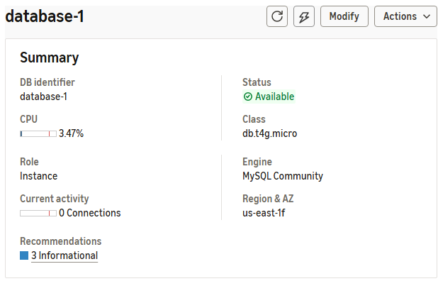
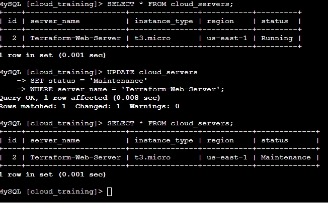

# AWS-RDS-MySQL-Integration
Private AWS RDS MySQL integration with EC2, VPC peering, security groups, DNS troubleshooting, and SQL CRUD operations.

# AWS RDS MySQL Integration

## Project Overview

Designed and implemented a private AWS relational database environment, connecting an Amazon EC2 instance to an Amazon RDS MySQL database across separate VPCs using VPC peering.

## Technologies Used

- Amazon Web Services (AWS)
- Amazon EC2
- Amazon RDS
- MySQL 8.4.11
- Amazon VPC
- VPC Peering
- Security Groups
- Amazon Linux 2023
- MariaDB Client
- Terraform
- SQL
- DNS Troubleshooting

## Architecture

EC2 Web Server (Training VPC)
        |
        | VPC Peering
        | TCP Port 3306
        |
RDS MySQL Database (Default VPC)

## Project Objectives

- Deploy a private MySQL database on AWS RDS.
- Establish communication between separate VPCs.
- Configure security group access.
- Resolve DNS and authentication errors.
- Connect EC2 to RDS using a MySQL-compatible client.
- Perform SQL CRUD operations.

## Database Configuration

- Database engine: MySQL
- Instance class: db.t4g.micro
- Region: us-east-1
- Database port: 3306
- Public access: Disabled
- Database name: cloud_training
- Table name: cloud_servers

## SQL Implementation

### Create Database

```sql
CREATE DATABASE cloud_training;
USE cloud_training;
```

### Create Table

```sql
CREATE TABLE cloud_servers (
    id INT AUTO_INCREMENT PRIMARY KEY,
    server_name VARCHAR(100),
    instance_type VARCHAR(50),
    region VARCHAR(50),
    status VARCHAR(20)
);
```

### Insert Data

```sql
INSERT INTO cloud_servers
(server_name, instance_type, region, status)
VALUES
('Terraform-Web-Server', 't3.micro',
'us-east-1', 'Running');
```

### Read Data

```sql
SELECT * FROM cloud_servers;
```

### Update Data

```sql
UPDATE cloud_servers
SET status = 'Maintenance'
WHERE server_name = 'Terraform-Web-Server';
```

### Delete Test Data

```sql
DELETE FROM cloud_servers
WHERE server_name = 'Test-Server';
```

## Troubleshooting

Successfully diagnosed and resolved:

- Incorrect database hostname entries
- DNS resolution failures
- MySQL authentication errors
- SQL record identification errors

Verified database connectivity and successful SQL operations from the EC2 Linux terminal.

## Security Practices

- Disabled public database access.
- Configured restricted inbound database access.
- Used private network communication.
- Avoided storing database credentials in source code.

## Cost Optimization

Stopped EC2 and RDS resources after completing testing to minimize compute charges.

## Project Results

- Successfully established EC2-to-RDS connectivity.
- Verified MySQL authentication.
- Created a cloud infrastructure inventory database.
- Successfully performed all four CRUD operations.
- Demonstrated cloud networking and troubleshooting skills.


## Screenshots

### AWS RDS Database Deployment


### Database Configuration


### MySQL Terminal Verification



### AWS Resource Cost Management


